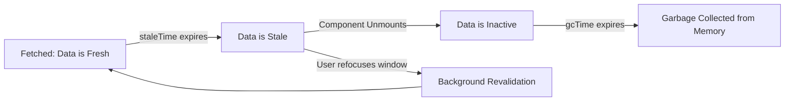

# 🚀 The Definitive Guide to TanStack Query in Next.js

Welcome to **TanStack Query** (commonly known as **React Query**)! This guide will teach you everything you need to understand, write, and master data fetching, caching, and state management in modern React and Next.js applications.

---

## 📌 Table of Contents
1. [What is TanStack?](#1-what-is-tanstack)
2. [Why TanStack Query? (Server State vs. Client State)](#2-why-tanstack-query-server-state-vs-client-state)
3. [The Old Way vs. The TanStack Way](#3-the-old-way-vs-the-tanstack-way)
4. [Core Concepts](#4-core-concepts)
   - [QueryClient & QueryClientProvider](#queryclient--queryclientprovider)
   - [Query Keys (`queryKey`)](#query-keys-querykey)
   - [Query Functions (`queryFn`)](#query-functions-queryfn)
   - [`staleTime` vs. `gcTime` (The Most Important Distinction)](#staletime-vs-gctime)
   - [Queries (`useQuery`)](#queries-usequery)
   - [Mutations (`useMutation`)](#mutations-usemutation)
   - [Cache Invalidation (`invalidateQueries`)](#cache-invalidation-invalidatequeries)
   - [Optimistic Updates](#optimistic-updates)
5. [TanStack Query in Next.js App Router](#5-tanstack-query-in-nextjs-app-router)
6. [Implementation in this Project (`Prepsmart`)](#6-implementation-in-this-project-prepsmart)
7. [Using the React Query Devtools](#7-using-the-react-query-devtools)
8. [Common Pitfalls & Best Practices](#8-common-pitfalls--best-practices)
9. [Cheat Sheet & Quick Reference](#9-cheat-sheet--quick-reference)

---

## 1. What is TanStack?

**TanStack** (created by Tanner Linsley) is a suite of headless, framework-agnostic libraries for modern web development:
- **TanStack Query** *(what we configured today)*: Powerful asynchronous state management and server-cache synchronization.
- **TanStack Table**: Headless datagrids, sorting, filtering, and column pinning.
- **TanStack Form**: Headless type-safe form validation and state management.
- **TanStack Virtual**: High-performance virtualized scrolling for massive lists.
- **TanStack Router**: Full-featured routing (mainly used in Vite / React SPA).

In our project, we use **`@tanstack/react-query`** and **`@tanstack/react-query-devtools`**.

---

## 2. Why TanStack Query? (Server State vs. Client State)

In React applications, state falls into two fundamental categories:

| State Type | Examples | Characteristics | Best Tool |
| :--- | :--- | :--- | :--- |
| **Client State** | Dark mode toggle, modal open/close, active tab | Synchronous, owned by the browser, temporary | `useState`, `useReducer`, Context |
| **Server State** | Users list, test scores, user profiles, database records | Asynchronous, remote, owned by the database, shared across users, can become stale | **TanStack Query** |

> [!IMPORTANT]
> **Server state is not your state!** It is merely a snapshot of data that lives in a remote database. The moment you fetch it, it can change on the server. TanStack Query treats remote data as an **asynchronous cache**, automatically handling synchronization, retries, background updates, and deduplication.

---

## 3. The Old Way vs. The TanStack Way

### ❌ The Old Way: Manual `useEffect` + `useState`
```tsx
// ❌ 30+ lines of boilerplate, race conditions, no caching, duplicate requests
function UsersList() {
  const [data, setData] = useState<User[]>([]);
  const [loading, setLoading] = useState(true);
  const [error, setError] = useState<string | null>(null);

  useEffect(() => {
    let ignore = false;
    setLoading(true);
    fetch("/api/users")
      .then((res) => res.json())
      .then((json) => {
        if (!ignore) {
          setData(json.data);
          setLoading(false);
        }
      })
      .catch((err) => {
        if (!ignore) {
          setError(err.message);
          setLoading(false);
        }
      });
    return () => { ignore = true; };
  }, []);

  if (loading) return <Spinner />;
  if (error) return <ErrorAlert error={error} />;
  return <ul>{data.map(u => <li key={u.id}>{u.name}</li>)}</ul>;
}
```

**Problems with the old approach:**
- No caching: every component mount fires a network request.
- No deduplication: 3 components needing users trigger 3 identical HTTP requests.
- No background revalidation when the window refocuses or reconnects.
- Cumbersome mutation handling: updating a user requires manually updating local state or re-fetching everywhere.

### ✅ The TanStack Way: Declarative `useQuery`
```tsx
// ✅ 4 lines, fully cached, auto-deduplicated, background-refetched, resilient
function UsersList() {
  const { data, isLoading, error } = useQuery({
    queryKey: ["users"],
    queryFn: () => fetch("/api/users").then((res) => res.json()),
  });

  if (isLoading) return <Spinner />;
  if (error) return <ErrorAlert error={error.message} />;
  return <ul>{data.data.map((u: User) => <li key={u.id}>{u.name}</li>)}</ul>;
}
```

---

## 4. Core Concepts

### QueryClient & QueryClientProvider
`QueryClient` holds the in-memory cache and configuration for all queries. It is provided to your React component tree using `QueryClientProvider`.

```tsx
import { QueryClient, QueryClientProvider } from "@tanstack/react-query";

const queryClient = new QueryClient();

export function App() {
  return (
    <QueryClientProvider client={queryClient}>
      <YourComponents />
    </QueryClientProvider>
  );
}
```

### Query Keys (`queryKey`)
A **Query Key** is a unique identifier (an array) that TanStack uses to cache, refetch, and serialize queries.

```ts
// All users
["users"]

// A specific user by ID
["users", userId]

// Filtered or paginated users
["users", { role: "ADMIN", page: 2 }]
```

> [!TIP]
> Always structure query keys hierarchically:
> - `["users"]` (all users)
> - `["users", "detail", userId]` (specific user)
> - Invalidation rule: Calling `invalidateQueries({ queryKey: ["users"] })` automatically invalidates both `["users"]` AND `["users", "detail", userId]`!

### Query Functions (`queryFn`)
Any async function that returns a promise. TanStack expects the promise to either:
1. **Resolve** with data, or
2. **Reject** with an Error (if using `fetch`, make sure to check `if (!res.ok) throw new Error(...)`).

```ts
queryFn: async () => {
  const res = await fetch("/api/users");
  if (!res.ok) {
    const errorBody = await res.json().catch(() => ({}));
    throw new Error(errorBody.error || "Failed to fetch users");
  }
  return res.json();
}
```

### `staleTime` vs. `gcTime`
This is the most critical concept to master in TanStack Query:



- **`staleTime` (Freshness)**:
  - Default: `0` (queries are immediately considered stale).
  - During `staleTime`, if a component mounts or the window refocuses, TanStack **will NOT fetch again**; it delivers cached data immediately.
  - In our project, we set a default `staleTime: 60 * 1000` (1 minute).
- **`gcTime` (Garbage Collection Time, previously `cacheTime`)**:
  - Default: `5 * 60 * 1000` (5 minutes).
  - Determines how long unused/inactive query data remains in memory after all consuming components have unmounted.

### Queries (`useQuery`)
Fetches and subscribes to data:

```tsx
const {
  data,          // The resolved data
  isLoading,     // True only on initial fetch with no cached data
  isFetching,    // True whenever a network request is in-flight (including background revalidations)
  isError,       // True if queryFn rejected
  error,         // The Error object
  refetch,       // Imperatively trigger a fetch
} = useQuery({
  queryKey: ["users"],
  queryFn: fetchUsers,
});
```

### Mutations (`useMutation`)
Unlike queries (which run automatically on mount), **mutations** are triggered imperatively to create, update, or delete server data (POST, PUT, DELETE).

```tsx
const createUser = useMutation({
  mutationFn: async (newUser: NewUserInput) => {
    const res = await fetch("/api/users", {
      method: "POST",
      headers: { "Content-Type": "application/json" },
      body: JSON.stringify(newUser),
    });
    if (!res.ok) throw new Error("Failed to create user");
    return res.json();
  },
  onSuccess: (data) => {
    // 💡 Auto-update cache or trigger notifications
    queryClient.invalidateQueries({ queryKey: ["users"] });
  },
  onError: (error) => {
    console.error("Mutation failed:", error);
  },
});

// Trigger the mutation:
createUser.mutate({ name: "Alice", email: "alice@example.com" });
```

### Cache Invalidation (`invalidateQueries`)
When a mutation succeeds, instead of manually editing your state arrays, you tell TanStack: *"Hey, the `["users"]` cache is outdated now!"*

```ts
queryClient.invalidateQueries({ queryKey: ["users"] });
```
TanStack Query will:
1. Mark the `["users"]` query as **stale**.
2. Immediately **refetch in the background** any active query currently displayed on screen.

### Optimistic Updates
For instant UI updates before the server responds:
```tsx
const mutation = useMutation({
  mutationFn: updateUserName,
  onMutate: async (newName) => {
    // 1. Cancel in-flight queries
    await queryClient.cancelQueries({ queryKey: ["user", id] });
    // 2. Snapshot current state
    const previousUser = queryClient.getQueryData(["user", id]);
    // 3. Optimistically set new data
    queryClient.setQueryData(["user", id], (old: any) => ({ ...old, name: newName }));
    // 4. Return context with snapshot
    return { previousUser };
  },
  onError: (err, newName, context) => {
    // Rollback if server fails
    queryClient.setQueryData(["user", id], context?.previousUser);
  },
  onSettled: () => {
    // Always re-sync with server after completion
    queryClient.invalidateQueries({ queryKey: ["user", id] });
  },
});
```

---

## 5. TanStack Query in Next.js App Router

Next.js App Router uses Server Components by default. Here is how TanStack fits in:

### Rule 1: Per-Request QueryClient
Never create `QueryClient` as a global module variable on the server! Doing so shares cache data across multiple users' requests.

```tsx
// ✅ Correct pattern in a "use client" provider:
"use client";
import { QueryClient, QueryClientProvider } from "@tanstack/react-query";
import { useState } from "react";

export function QueryProvider({ children }: { children: React.ReactNode }) {
  // useState ensures QueryClient is instantiated once per browser session
  const [queryClient] = useState(
    () =>
      new QueryClient({
        defaultOptions: {
          queries: { staleTime: 60 * 1000 },
        },
      })
  );

  return <QueryClientProvider client={queryClient}>{children}</QueryClientProvider>;
}
```

### Rule 2: Server Component Prefetching (Hydration Pattern)
You can prefetch queries on the server and hydrate them to client components with 0 initial loading state:

```tsx
// app/users/page.tsx (Server Component)
import { QueryClient, dehydrate, HydrationBoundary } from "@tanstack/react-query";
import { UserListClient } from "./UserListClient";

export default async function UsersPage() {
  const queryClient = new QueryClient();

  await queryClient.prefetchQuery({
    queryKey: ["users"],
    queryFn: fetchUsersFromDb,
  });

  return (
    <HydrationBoundary state={dehydrate(queryClient)}>
      <UserListClient />
    </HydrationBoundary>
  );
}
```

---

## 6. Implementation in this Project (`Prepsmart`)

We set up a clean, modular TanStack Query architecture in this codebase:

### 1. The Global Provider
File: [`src/providers/QueryProvider.tsx`](file:///home/ezekiel/projects/collaborations/Prepsmart/src/providers/QueryProvider.tsx)
- Instantiates `QueryClient` with sensible defaults (1 min stale time, retries disabled in development).
- Injects `<ReactQueryDevtools initialIsOpen={false} />` automatically.
- Wrapped inside [`src/app/layout.tsx`](file:///home/ezekiel/projects/collaborations/Prepsmart/src/app/layout.tsx).

### 2. Custom Hooks
File: [`src/hooks/useUsers.ts`](file:///home/ezekiel/projects/collaborations/Prepsmart/src/hooks/useUsers.ts)
- **`useUsersQuery()`**: Queries `/api/users`, strongly typed with our Zod-validated response.
- **`useCreateUserMutation()`**: Sends a POST request, triggers toast/alert, and calls `queryClient.invalidateQueries({ queryKey: ["users"] })`.

```ts
export function useCreateUserMutation() {
  const queryClient = useQueryClient();

  return useMutation({
    mutationFn: async (payload: CreateUserInput) => {
      const res = await fetch("/api/users", {
        method: "POST",
        headers: { "Content-Type": "application/json" },
        body: JSON.stringify(payload),
      });
      const data = await res.json();
      if (!res.ok) throw new Error(data.error || "Failed to create user");
      return data;
    },
    onSuccess: () => {
      // Automatic cache invalidation
      queryClient.invalidateQueries({ queryKey: ["users"] });
    },
  });
}
```

### 3. Client Component
File: [`src/app/users/UserManagementClient.tsx`](file:///home/ezekiel/projects/collaborations/Prepsmart/src/app/users/UserManagementClient.tsx)
- Demonstrates loading spinners (`isLoading`), refetch buttons (`refetch()`), background synchronization indicators (`isFetching`), and instant mutation updates.

---

## 7. Using the React Query Devtools

We installed and connected **React Query Devtools**.

### How to use it:
1. Open your browser at `http://localhost:3000/users`.
2. Look at the bottom-right corner of your screen: you will see a small flower/lotus icon.
3. Click it to open the Devtools drawer!
4. **Inspect Queries**: See `["users"]` in real time. Notice:
   - **`fresh` (green)**: Query is inside `staleTime`.
   - **`stale` (yellow)**: Query is ready to refetch when triggered.
   - **`fetching` (blue)**: Request is actively downloading.
5. Try clicking **"Refetch"** or **"Invalidate"** directly in devtools to watch your React components update automatically!

---

## 8. Common Pitfalls & Best Practices

| Pitfall | Why it's bad | Solution |
| :--- | :--- | :--- |
| **Storing server data in `useState`** | Duplicate source of truth, causes stale state bugs | Rely directly on `const { data } = useQuery(...)` |
| **Using string query keys** (`useQuery({ queryKey: 'users' })`) | Deprecated in TanStack v5 | Always use arrays: `queryKey: ['users']` |
| **Forgetting to check `res.ok` in `fetch`** | `fetch` doesn't reject on 404 or 500 HTTP errors | Throw an error if `!res.ok` so TanStack marks query as error |
| **Inline query functions** | Difficult to test and reuse | Write custom hooks (`useUsersQuery()`) in `src/hooks/` |
| **Global QueryClient in Next.js Server** | Leaks session cache across different users | Use `useState(() => new QueryClient())` inside client provider |

---

## 9. Cheat Sheet & Quick Reference

### Creating a new Query Hook:
```ts
// src/hooks/useProducts.ts
import { useQuery } from "@tanstack/react-query";

export function useProduct(id: string) {
  return useQuery({
    queryKey: ["products", id],
    queryFn: async () => {
      const res = await fetch(`/api/products/${id}`);
      if (!res.ok) throw new Error("Failed to load product");
      return res.json();
    },
    enabled: Boolean(id), // Only fetch if ID is present
    staleTime: 5 * 60 * 1000, // Fresh for 5 minutes
  });
}
```

### Creating a new Mutation Hook:
```ts
// src/hooks/useDeleteProduct.ts
import { useMutation, useQueryClient } from "@tanstack/react-query";

export function useDeleteProduct() {
  const queryClient = useQueryClient();

  return useMutation({
    mutationFn: async (id: string) => {
      const res = await fetch(`/api/products/${id}`, { method: "DELETE" });
      if (!res.ok) throw new Error("Failed to delete product");
      return res.json();
    },
    onSuccess: () => {
      queryClient.invalidateQueries({ queryKey: ["products"] });
    },
  });
}
```

Now you are fully equipped to build resilient, fast, and scalable server-state experiences with TanStack Query!
